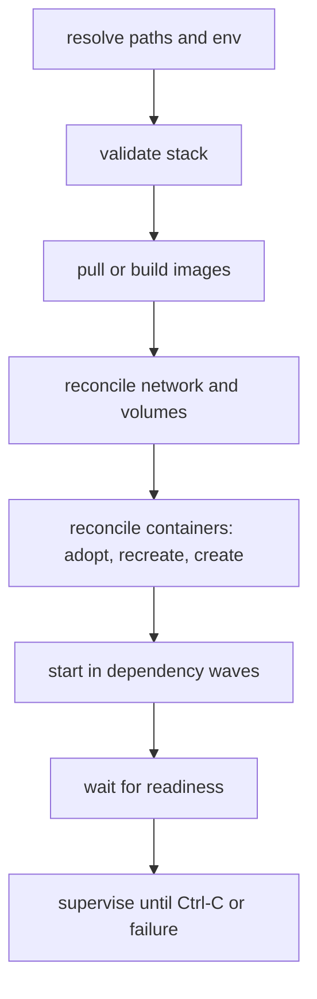

# 01 — The model

Status: design, 2026-10-24.

What this tool manages, what it does not, and the rules that make `down` safe to
run. Read [`02-stack-file.md`](02-stack-file.md) for the file format and
[`04-runtime.md`](04-runtime.md) for the runtime facts this model is built on.

## Vocabulary

| term | means |
|---|---|
| **project** | one instantiation of a stack, identified by a name. Every resource the tool creates carries it. |
| **stack** | the contents of one `stack.toml`. |
| **service** | one container. In v1 the mapping is 1:1 and there is no `scale`. |
| **volume** | a named volume owned by the project. |
| **network** | the runtime's `default` network, or a per-project network. |
| **resource** | anything the tool creates: container, volume, network. |

A service is not a process group, a pod or a unit. It is a container with a
name, a config hash and a lifecycle.

## Naming

```
<project>-<service>     containers      mitos-sieve
<project>-<volume>      volumes         mitos-data
<project>-net           network         mitos-net      (isolated mode only)
```

`<project>` matches `[a-z0-9][a-z0-9-]{0,30}` and `<service>` matches
`[a-z0-9][a-z0-9-]{0,30}`. Invalid names are a load error, not a sanitised
version of what was written.

Dashes rather than underscores because a container's name doubles as its DNS
label (`mitos-sieve.test`). A name that is not a legal DNS label would work as
a container name and fail as a hostname, which is the kind of split-brain the
tool exists to remove. The label is usable only once a DNS domain is registered
on the host, which is admin setup the tool does not perform — see
[`04-runtime.md`](04-runtime.md#dns-is-a-two-step-setup).

The name is the identity. The tool never tracks a container ID between
invocations — it lists, filters by label, and matches by name. An ID is a
handle for one process lifetime; the name is the contract.

## Ownership

Four labels, on every container, volume and network the tool creates:

```
dev.container-compose.project = mitos
dev.container-compose.service = sieve        # containers only
dev.container-compose.config  = 3f9c1a2b7d4e0055
dev.container-compose.schema  = 1
```

A resource is **ours** when the `project` label matches the current project. A
resource is **ours and current** when its name is also in the plan. The two
together are what make `down` safe: `down` deletes only resources that are ours,
and it says what it deleted.

`container delete --all`, `container volume prune` and
`container network prune` are never used by this tool. `--all` includes other
people's work and `prune` deletes data irrecoverably — see the volume warning in
[`04-runtime.md`](04-runtime.md#volumes).

### Adopt, recreate or refuse

`up` reconciles each resource by name, in this order:

| situation | behaviour |
|---|---|
| name absent | create. |
| ours, `config` matches | adopt. Start it if stopped. Never recreate a matching container on every `up`. |
| ours, `config` differs | **recreate**: stop, delete, create. State in named volumes survives; state in the container's writable layer does not. `--no-recreate` refuses instead and exits 3. |
| ours, no longer in the file | report as an orphan. `up` does not touch it; `down` removes it. |
| name exists, not ours | **refuse**, exit 3, print the existing container's labels so the collision is obvious. |
| volume exists, not ours | refuse; a volume holds data and guessing is not available. |
| network exists, not ours | attach if its subnet matches the stack, otherwise refuse. |

Refusing is a feature. Adopting a container the tool did not create means `down`
later deletes someone else's work, and there is no way to tell that it was a
mistake after the fact.

The config hash is computed from the **resolved** stack, not the file bytes, so
comments, key order and `depends_on` do not cause churn — see
[`02-stack-file.md`](02-stack-file.md#the-config-hash).

## Lifecycle

`up` runs these phases in order, and stops at the first failure:



Nothing is written before phase C. A stack file that fails validation never
touches the runtime, so `plan` and a failed `up` leave the machine exactly as it
was.

Phases D and E are ordered so a container is never created against a resource
that does not exist yet. They are not transactional in the other direction: if
container 3 of 5 fails to create, containers 1 and 2 exist.

`container start` returns before the container is running: the state is still
`stopped` when the command exits, and `running` a second or two later. The start
phase therefore polls `list --all` until the service is `running`, and a
`depends_on: service_started` edge is satisfied by that state rather than by the
command returning.

### Partial failure

When phase C–G fails:

1. No further step runs.
2. Services **started by this invocation** are stopped — not deleted, not
   removed. Their writable layer and their volumes survive, so `up` again or
   `logs` can pick up where it left off. `--keep-started` leaves them running
   instead.
3. The error names the step, the service, the exact `container` argv, the exit
   code and the captured stderr, then suggests the next command.
4. Exit code 4 when the failure was readiness (a container is running but not
   healthy within `start_period + retries × interval`), 1 otherwise.

Services that were already running before this invocation, and matched their
config, are not stopped on someone else's failure. The tool records what it
started in this run and stops only that set.

### `down`

Reverse dependency order, then:

1. `container stop --time <timeout>` each running service.
2. `container delete` each container, force only for one that would not stop.
3. `container volume delete` each owned volume — **only with `--volumes`**.
4. `container network delete` the project network, if the tool created it.

Volumes are the only thing `down` does not remove by default, because volume
deletion is unrecoverable and `down`/`up` is a loop people run casually.
`--volumes` is the opt-in, and it prints each volume before deleting it.

## The supervisor decision

`container` has **no restart policy**. Docker's `--restart=always` is a daemon
behaviour, and there is no daemon here: the apiserver starts a VM and walks
away. Nothing outside this process will start a container that exited.

So supervision can only be a property of a process that is alive, and the design
makes that explicit rather than pretending otherwise:

- `up` without `-d` runs a foreground supervisor. That is the default because it
  is the only mode where `restart` means anything.
- `up -d` is allowed **only** when every service is `restart = "no"`. A stack
  that asks for restarts and asks to be detached is asking for a promise the
  runtime cannot keep; `up` exits 3 and says so.
- `restart` is therefore a stack-file property that the *tool* honours, not a
  property passed to `container`. It never appears in the `container` argv, and
  `plan` says so.

The supervisor is a loop with no threads per service:

```
every poll_interval (default 1s):
    list --all --format json, filter by project label
    for each service:
        state changed?  → log the transition
        stopped?        → restart per policy, with backoff
        running?        → run a due healthcheck
    write the health cache only when a state changes; keep the rest in memory
```

Restart policy:

| policy | restarts when |
|---|---|
| `no` | never. |
| `on-stop` | the container is not running and this process did not stop it. Gives up after `max_retries` (default 5). |
| `always` | any exit, including zero. Backoff still applies; there is no attempt limit. |

The runtime records **no exit code**: `list` and `inspect` report `running` or
`stopped`, nothing more. So a policy that tests the exit status cannot be
implemented, and `on-stop` is named for what the tool can actually observe. The
supervisor sets an intent immediately before it stops a service and clears it on
the next start; a transition to `stopped` without intent is the policy's
trigger. A `container stop` typed in another terminal is indistinguishable from
a process exit — that is a runtime gap, not an omission — which is why the
documented way to stop a supervised service is to stop the supervisor or run
`down`.

Backoff is 1 s, 2 s, 4 s, 8 s, 16 s, capped at 30 s, reset after the container
has stayed up for 60 s. A crash loop therefore settles at one restart every
30 s instead of pinning a core, and the log line names the attempt count and the
last health result.

Healthchecks are `container exec` calls on a schedule, because the runtime has
no healthcheck of its own. A healthcheck is only meaningful while the container
runs; an exited container is `unknown`, not `unhealthy`. An unhealthy service is
reported in `ps`, blocks `depends_on: service_healthy` for anything that comes
after it, and does **not** trigger a restart in v1 — restarting a service because
its probe is slow is how a dev loop turns into a flapping loop.

A probe has three outcomes, not two. Exit 0 is healthy. A non-zero exit is a
failed probe and counts toward `retries`. `container exec` failing because the
container is not running is `unknown` and counts for nothing. A probe binary
that does not exist also exits non-zero, and is worth naming separately: the
healthcheck can never pass, and the message says which binary is missing.

Health is a property of the supervision session, not of the container, because
nothing in the runtime records it. The supervisor writes a small per-project
cache — `~/Library/Caches/container-compose/<project>.json`, holding its pid and
the last result per service — and `ps` reads it. A missing file, a pid that is
gone, or a config-hash mismatch means `unknown`, never a stale "healthy". The
cache is never authority: `up` readiness uses in-process state, deleting the
file changes only what `ps` prints, and failing to write it warns rather than
failing the stack.

### Ctrl-C

The first SIGINT stops the supervisor, then stops services in reverse dependency
order with `container stop --time <timeout>`, then exits 0. Containers and
volumes remain, so `up` is fast and `logs` still works.

The second SIGINT skips the graceful stop and issues `container kill`, then
exits 130. `--no-stop-on-exit` makes the first SIGINT behave like `-d`: leave
everything running.

Foreground `up` never deletes. Stopping is reversible; deletion belongs to
`down`.

## Constraints the model accepts

**One running container per named volume.** Measured on the runtime: a second
container cannot attach a volume that a running container holds, even
read-only — `start` fails with `The storage device attachment is invalid`. A
stopped holder releases it. The tool therefore validates that a volume is
mounted by at most one service, `:ro` included. A stack that needs two services
to see the same data uses a host bind mount, which the runtime does document as
shareable, or one container running both processes.

**No cross-project sharing.** A volume or network belongs to exactly one
project. Two stacks that need the same data share it through a bind mount, where
the ownership question is the filesystem's rather than the tool's.

**Bind mounts are the escape hatch.** A relative host path is resolved against
the directory holding the stack file, and a missing path is a load error rather
than a silently-created empty directory.

**No `scale`.** Two instances of a service need two names, two healthchecks and
two sets of published ports, and none of that is expressible in v1. Run a second
project instead.

## What is deliberately absent

- **No daemon.** The runtime and the labels are the authority; the tool keeps
  nothing between invocations except the supervisor's health cache, which only
  `ps` reads and the next `up` rebuilds.
- **No Compose YAML.** See
  [`02-stack-file.md`](02-stack-file.md#why-not-compose-yaml).
- **No launchd integration.** Generating a LaunchAgent that runs `up` in the
  foreground is a plausible M4, and it is the honest way to get supervision
  without a terminal. It is not in v1, because a generated unit that silently
  lapses after a reboot is worse than a terminal you can see.
- **No image building beyond one `container build` call.** No BuildKit flags
  beyond pass-through, no layer cache policy of our own.
